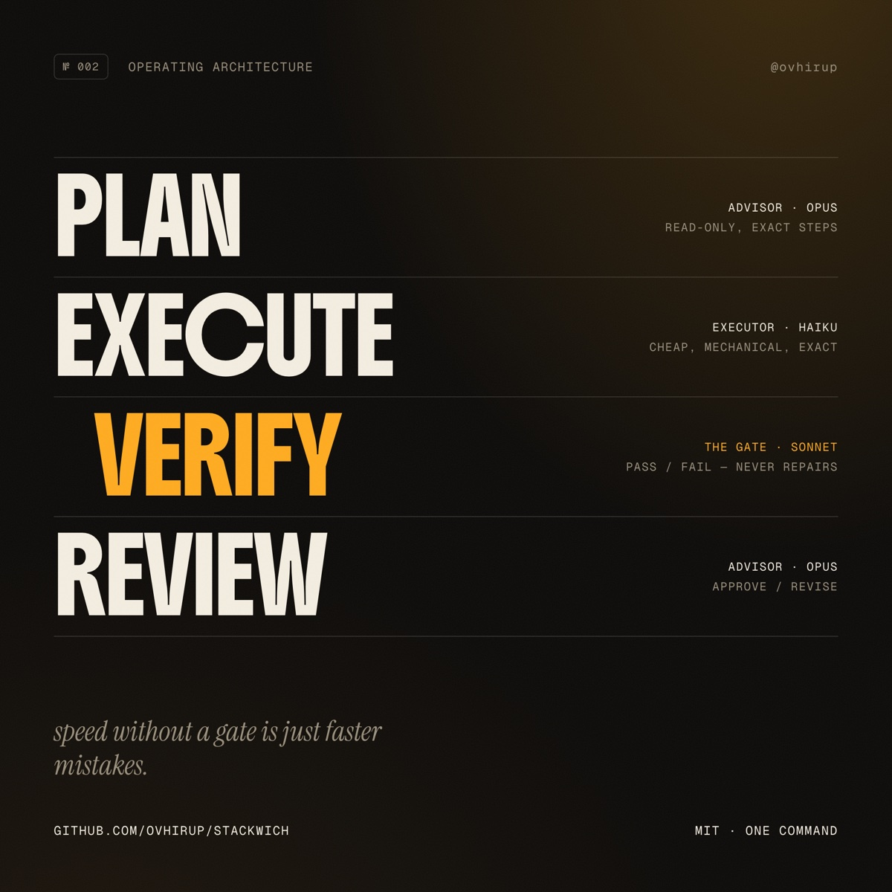

# 🥪 stackwich

[](https://github.com/ovhirup/stackwich/actions/workflows/validate.yml)
[](LICENSE)
[](https://docs.claude.com/en/docs/claude-code/skills)

**Delivery discipline for AI agents. Five layers, one command.**

Most people run AI coding agents like slot machines: prompt → pull the lever → hope. The agent writes code 10× faster than you review it, declares itself done, and you find out later. We would never accept that from a junior engineer — we accept it from our tools every day.

Stackwich is 15 years of delivery coaching — plan → build → test → review, the oldest idea in software — compressed into standing policy for [Claude Code](https://docs.claude.com/en/docs/claude-code). Install it once and every future session works this way.

**See it first:** the [Stackwich showcase](https://abhirupbanerjee.com/stackwich) is an interactive tour of the workflow and its models. This README is the install guide.



## The five layers

| Layer | Habit |
|---|---|
| **Prompt** | Meta-prompt every delegation. Context-full, with a stated done condition. Understanding never gets delegated. |
| **Context** | Fork research and read-heavy scans off the main thread. Memory, plans, and tasks each do their own job. |
| **Harness** | One writer. Read-only roles stay read-only in practice, not just in the tool list. Nothing "done" until observed. |
| **Loop** | Recurring work runs on `/loop`. Failure loops are capped at 2 cycles and never silent. |
| **Graph** | `advisor` plans → `executor` implements → `verifier` gates → `advisor` reviews, with explicit hand-off contracts. |

Cost discipline isn't a sixth layer — it's how the five are practiced: cheap models grind, expensive models only plan and review, and nothing already established gets re-derived.

The layer names are structure for the humans auditing the setup. Inside the installed policy block they're section headers only; every bullet under them is a behavioral imperative, because that block is read on every turn and prose explaining a taxonomy would cost tokens without changing an action.

## The sandwich

| Stage | Agent | Model | Contract |
|---|---|---|---|
| 🍞 **Plan** | `advisor` | opus | Read-only: no edit tools; `Bash` for inspection by instruction. Exact files, exact edits, a verification command per step. Flags anything irreversible. |
| 🥩 **Execute** | `executor` | haiku | Mechanical and exact. No redesigns, no improvising, no suffixed file copies. |
| 🧪 **Verify** | `verifier` | sonnet | Runs the project's real tests/lint/build. `GATE: PASS` or `GATE: FAIL` — never repairs. |
| 🍞 **Review** | `advisor` | opus | Diff vs. plan, conventions, blast radius. `APPROVE` or `REVISE: <list>`. |

Small, reversible changes skip the ceremony — the verifier alone closes the loop. If the same verification fails twice, iteration stops and escalates to the advisor. Speed without a gate is just faster mistakes.

Most of this is policy the model is instructed to follow, not a boundary the runtime enforces. [What Stackwich enforces](docs/enforcement.md) lists, per mode, which checks are mechanical, which depend on the model following instructions, and which guarantees are not provided.

## Install

This repository, [`ovhirup/stackwich`](https://github.com/ovhirup/stackwich), is the canonical source, and the plugin below is the only supported install path. Instructions elsewhere that clone a repository into a skills directory describe the pre-3.0 layout — see [Older copies](#older-copies).

Add the marketplace, then install the plugin. Both are slash commands, typed inside a Claude Code session:

```
/plugin marketplace add ovhirup/stackwich
/plugin install stackwich@stackwich
```

Then run:

```
/stackwich:stackwich
```

Plugin skills are namespaced by the plugin that ships them, which is why the name doubles here — the plugin and the skill are both called `stackwich`. Bare `/stackwich` only resolves if you still have a pre-3.0 standalone copy installed, which the upgrade steps below tell you to remove.

The skill does the rest interactively: asks for scope, writes the policy, offers the three agents. Claude Code protects `CLAUDE.md` and files outside your project, so expect permission prompts to write `CLAUDE.md`, to read the plugin's agent files, and to create the `agents/` folder — approve them, or the skill reports each step 4 check as FAIL and changes nothing. Run `/agents` afterwards to confirm `advisor`, `executor`, and `verifier` are picked up. Re-running it on an existing install detects the marker and offers an in-place upgrade.

New to Stackwich? [Your first verified task](docs/first-task.md) walks from install to a verified fix on a small demo and back out again. To list what is installed at each level and any conflicts, run `python3 tools/diagnose.py` from your project. No browser or API tests in your project? [Acceptance-check recipes](docs/recipes.md) give the verifier something real to run. To bind a `GATE: PASS` to the exact files it tested, see [verification records](docs/verify-gate.md); to pick up interrupted work safely, see [handoffs](docs/handoff.md). To check what an install left behind, run `python3 tools/check_install.py ~/.claude` from a clone of this repository (or `./.claude` for a project-level install). It reads files only and reports each marker, revision, block, and agent check as PASS or FAIL. [docs/evals.md](docs/evals.md) explains these checks and the separate behavior evals.

### Upgrading from 2.x

**The move itself changes nothing about your policy.** 3.0 left your `CLAUDE.md` block at `policy-rev 3` and your `advisor`, `executor` and `verifier` untouched — only the delivery mechanism moved. Releases from 3.1.0 on do change the policy; see [CHANGELOG](CHANGELOG.md), and re-run `/stackwich:stackwich` to apply the current revision in place.

Before 3.0, Stackwich was installed by cloning this repo into a skills directory. Install the plugin above, then remove the old clone — leaving it in place gives you two skills both named `stackwich`:

```bash
rm -rf ~/.claude/skills/stackwich      # user level
rm -rf ./.claude/skills/stackwich      # project level, in each repo you installed it into
```

**Don't `git pull` instead.** The skill no longer lives at the repo root, so pulling into an existing clone deletes `SKILL.md` and `assets/` and leaves a directory Claude Code can load as neither a skill nor a plugin. `/stackwich` stops resolving — with no error, and no pointer to the new install method.

## Versions

Four numbers move independently. Only the policy revisions change what an installed session does.

| Number | Current | Where it lives | When you act |
|---|---|---|---|
| Repository and plugin version | 3.4.0 | `plugin.json`, git tags `vX.Y.Z`, [CHANGELOG](CHANGELOG.md) headings | Update the plugin. |
| Claude Code policy revision | `policy-rev 7` | The comment inside the `<!-- stackwich:v1 -->` block in your `CLAUDE.md` | Re-run `/stackwich:stackwich` when it changes. |
| Grok port revision | `stackwich-grok-rev 4` | Inside the block the Grok port writes | Re-apply the Grok port when it changes. |
| Codex port revision | `stackwich-codex-rev 5` | Inside the `<!-- stackwich-codex:v1 -->` block in `AGENTS.md` | Re-apply the Codex port when it changes. |

A repository release can leave every policy revision unchanged; 3.2.0 did, while 3.3.0 and 3.4.0 each moved all three. Each CHANGELOG entry says whether there is anything to re-run. The markers themselves never change.

### Older copies

[`abhirup-artizent/stackwich`](https://github.com/abhirup-artizent/stackwich) is an older copy. Its README still describes cloning this repository into `~/.claude/skills/stackwich`, which no longer works: the skill moved under `plugins/` in 3.0, so a clone gives a directory Claude Code loads as neither a skill nor a plugin. Install the plugin above instead, and follow [Upgrading from 2.x](#upgrading-from-2x) if you installed from a clone.

## What it writes

| Path | What |
|---|---|
| `<scope>/CLAUDE.md` | The operating policy, fenced between `<!-- stackwich:v1 -->` markers — updates in place, never duplicates |
| `<scope>/agents/advisor.md` | Read-only planner/reviewer (opus) |
| `<scope>/agents/executor.md` | Cheap mechanical executor (haiku) |
| `<scope>/agents/verifier.md` | PASS/FAIL verification gate (sonnet) |

`<scope>` is `~/.claude` (user level — every project, the recommended default) or `./.claude` (this project only). Already have your own plan/execute/verify agents? Keep them — Stackwich is the policy; the three files are just a default implementation, and the installer handles name collisions.

## Design notes

**The marker never changes.** `<!-- stackwich:v1 -->` is the permanent search key; the actual revision lives on a `policy-rev` comment inside the block. If the marker were versioned, a newer release couldn't find older installs to upgrade. The rule binds each port to whatever marker it shipped with: `grok/` reuses `stackwich:v1`, while `codex/` writes `<!-- stackwich-codex:v1 -->` to `AGENTS.md` and keeps it — renaming a marker that is already installed somewhere is precisely the upgrade break this rule exists to prevent.

**Single writer.** Only `executor` mutates the filesystem. `advisor` and `verifier` have no edit tools, and their `Bash` is for inspection and verification, scoped away from writes by instruction — a fix from a reviewer is an unreviewed change nobody knows exists. The tool list is enforced by Claude Code; the `Bash` boundary depends on the model following it. Tests and builds the verifier runs can still create caches and build output; what read-only protects is product source and external state. See [docs/enforcement.md](docs/enforcement.md).

**Loops are capped.** `GATE: FAIL` and `REVISE:` both route back to `executor` with the original plan attached, for at most 2 cycles. On the third, it stops and surfaces everything to the human. Verdict lines are fixed strings so routing doesn't depend on interpreting prose; the main session still does the routing, and the cap is instructed, not counted by a tool.

**Input contracts are explicit.** Each agent states what it must receive and is instructed to stop when a piece is missing rather than reconstruct it — a reviewer that rebuilds the plan from the diff reviews the change against itself and approves anything self-consistent.

## Repo layout

```
stackwich/
├── .claude-plugin/
│   └── marketplace.json          # the marketplace catalog
├── plugins/stackwich/
│   ├── .claude-plugin/
│   │   └── plugin.json           # the plugin manifest
│   ├── LICENSE
│   └── skills/stackwich/
│       ├── SKILL.md              # the skill: install workflow + policy block
│       └── assets/               # read on demand, never on every trigger
│           ├── advisor.md        # agent definitions, read only when scaffolding is accepted
│           ├── executor.md
│           ├── verifier.md
│           └── rebound.md        # cost/rebound playbook, read only for cost or loop questions
├── evals/evals.json              # five install paths + two policy-behavior cases
├── tools/                        # check_install, diagnose, uninstall, verify_gate, and handoff
├── examples/first-task/          # the demo project for docs/first-task.md
├── recipes/                      # API, browser-flow, responsive, and accessibility checks
├── docs/sandwich.jpg
├── docs/teams-layer.md           # measured-layer design note
├── docs/enforcement.md           # which safeguards are mechanical vs. instructed
├── docs/evals.md                 # deterministic checks vs. behavior evals, and how to run each
├── docs/first-task.md            # install → diagnose → fail → fix → verify → uninstall
├── docs/verify-gate.md           # bind verification verdicts to the tree they tested
├── docs/handoff.md               # resume interrupted work and see what changed since
├── docs/recipes.md               # acceptance-check recipes and what each does not check
├── measured/                     # optional local JSONL log, report, and approval gate
├── grok/                         # Grok port (stackwich-grok) — not a Claude Code skill
├── codex/                        # Codex port (stackwich-codex) — not a Claude Code skill
├── CHANGELOG.md
├── LICENSE
└── README.md
```

`assets/` is kept out of `SKILL.md` deliberately: progressive disclosure. The agent definitions are ~150 lines that don't need to enter context on every trigger, and never at all when the user declines the scaffolding.

## Measured layer (Teams)

Optional local instrumentation beside the skill. It does not change the installed policy (it never changes `policy-rev`) and it is not written into `CLAUDE.md`.

`measured/` appends sandwich, model-tier, human-gate, and delivery events to a JSONL file on disk. `measured/report.py` prints a Markdown or JSON report: verification pass rate, review approve rate, human gate pass rate, hours returned, retro scores, commitment versus carryover, DORA numbers, and open risks. `measured/approve.py` is a four-role dry-run and approval gate. It refuses a change where the planner, writer, verifier, and approver names collide, and a dry run writes nothing. It does not authenticate who supplied each name or bind approval to an exact diff — it is a local workflow check, not proof of four distinct people.

Azure DevOps and Jira are export targets. There is no tracker client and no dashboard service. The public demo log is `measured/examples/sprint.jsonl`. The design note is [docs/teams-layer.md](docs/teams-layer.md).

```bash
python3 measured/report.py --log measured/examples/sprint.jsonl
python3 measured/approve.py --self-check
python3 measured/test_measured.py
```

## Uninstall

```
/plugin uninstall stackwich
/plugin marketplace remove stackwich
```

The agents were scaffolded into your own agents directory, not shipped by the plugin, so removing the plugin leaves them and the `CLAUDE.md` block behind. From a clone of this repository, preview and then remove them for each scope you installed into:

```bash
python3 tools/uninstall.py ~/.claude            # user level: prints what it would remove
python3 tools/uninstall.py ~/.claude --apply    # removes it, after backing up CLAUDE.md
python3 tools/uninstall.py ./.claude --apply    # project level, in each repo
```

It removes the `<!-- stackwich:v1 -->` block and only the agent files that carry the Stackwich author credit, including ones renamed for a collision. Your own agents and the rest of `CLAUDE.md` are kept. Don't delete `advisor.md`, `executor.md`, and `verifier.md` by name: if you renamed a Stackwich agent to avoid a collision, the file called `executor.md` is your own.

## FAQ

**Does it audit my existing code?** No. It's forward-looking policy — it changes how future work gets done, nothing retroactive.

**Will it slow me down?** Only where slow is the point. Small, reversible edits run exactly as before; the full sandwich fires only when a change is hard to reverse, touches shared systems, or spans repos.

**Why these three models?** Tiering is the cost control: opus judgment where it pays (plan/review), haiku hands where it doesn't (mechanical edits), sonnet in between as the gate. Swap models in the agent frontmatter if your stack differs.

## Author

Built by **Abhirup Banerjee** ([@ovhirup](https://github.com/ovhirup)) — AI-native Agile coach; SAFe, PI Planning, and large BFSI delivery programs. Stackwich is that delivery discipline, ported to agents.

MIT — see [LICENSE](LICENSE). Forks and mirrors welcome — please keep the attribution lines in `SKILL.md` and the agent files intact. If it saves you a bad merge, a ⭐ is appreciated.
