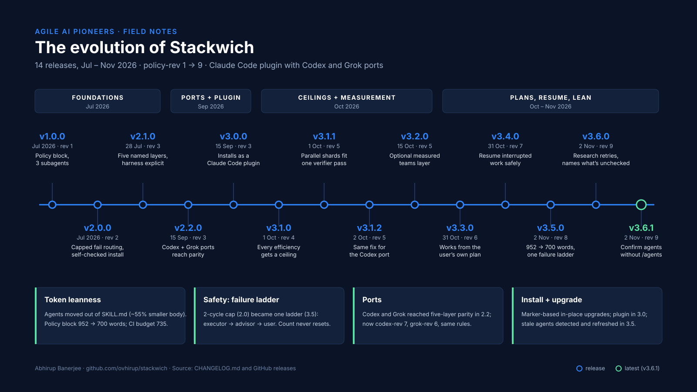
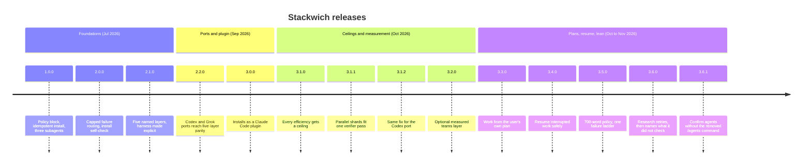

# How Stackwich evolved

Stackwich went from a single skill with a policy block (1.0.0, July 2026) to a Claude Code plugin
with Codex and Grok ports, an optional measured layer, and policy-rev 9. The latest release is 3.6.1 (2 Nov 2026), the 14th.
Every fact below comes from [CHANGELOG.md](../CHANGELOG.md) and the GitHub releases.

## Timeline

## Release by release

Dates are tag commit dates. 1.0.0 and 2.0.0 have no tags; they predate 2.1.0 (28 Jul 2026), and the
first commit is 22 Jul 2026.

| Date | Version | policy-rev | What changed | Value added |
|---|---|---|---|---|
| Jul 2026 | 1.0.0 | 1 | Policy block, marker-based install, three subagents, two-strike rule | A repeatable advisor / executor / verifier setup |
| Jul 2026 | 2.0.0 | 2 | Agent files moved to `assets/`; `GATE: FAIL` and `REVISE:` routed back to `executor`, capped at 2 cycles; install verifies itself | About 55% smaller skill body per trigger; revise loops are bounded |
| 28 Jul 2026 | 2.1.0 | 3 | Policy reorganised under Prompt / Context / Harness / Loop / Graph | Each rule has a clear place; audits become mechanical |
| 15 Sep 2026 | 2.2.0 | 3 | Codex and Grok ports adopt the five layers; CI checks markers as whole lines | Ports cannot drift silently |
| 15 Sep 2026 | 3.0.0 | 3 | Ships as a Claude Code plugin marketplace | Install with `/plugin install`; policy and agents unchanged |
| 1 Oct 2026 | 3.1.0 | 4 | Loops state a stop condition and a max run count; shard counts are stated; done reports count delegations | Cheaper steps can't quietly raise total spend or review load |
| 1 Oct 2026 | 3.1.1 | 5 | Only launch as many shards as one verifier pass can check | Fixes review overload left in 3.1.0 |
| 2 Oct 2026 | 3.1.2 | 5 | Codex port gets the same parallel-run rule (codex-rev 3) | Codex matches the parent |
| 15 Oct 2026 | 3.2.0 | 5 | Optional `measured/` layer: append-only log, report, four-role approval gate | Team runs can be recorded and reported locally |
| 31 Oct 2026 | 3.3.0 | 6 | An existing plan, spec or ticket is the plan; adds `check_install.py`, `diagnose.py`, `uninstall.py`, `verify_gate.py`, recipes | Respects the user's plan; installs can be checked and removed cleanly |
| 31 Oct 2026 | 3.4.0 | 7 | `.stackwich/handoff.md` and `tools/handoff.py` | Interrupted work resumes with changes flagged as unverified |
| 2 Nov 2026 | 3.5.0 | 8 | Policy cut from 952 to 700 words; one failure ladder; scans go to forks; stale agents refreshed on upgrade; `tools/validate.py` | Fewer tokens every turn; a clear escalation path; upgrades really update |
| 2 Nov 2026 | 3.6.0 | 9 | Research forks retry thin results at most twice, then report `Sources:`, `NOT FOUND:`, `UNCHECKED:` | Gaps in research are stated, not hidden |
| 2 Nov 2026 | 3.6.1 | 9 | Installer report and README say to ask Claude to list subagents instead of running the removed `/agents` | Install confirmation works on current Claude Code |

## Themes

**Token leanness.** The policy block is read on every turn, so size matters. 2.0.0 moved agent
definitions out of `SKILL.md`. 3.5.0 cut the block from 952 to 700 words by removing lines that
restate Claude Code's own behaviour, and CI now fails past 735 words. 3.6.0 sits at 734.

**Safety and the failure ladder.** 1.0.0 had a two-strike rule; 2.0.0 added a 2-cycle cap on
`GATE: FAIL` and `REVISE:`. 3.5.0 replaced both with one ladder: first failure back to `executor`,
second to `advisor` to re-plan, third to the user. The count never resets. 3.1.x added ceilings on
loops and parallel work.

**Ports to Codex and Grok.** Both ports reached five-layer parity in 2.2.0 and have followed each
policy change with their own revision counters, reaching `stackwich-codex-rev 7` and
`stackwich-grok-rev 6` in 3.6.0. Grok runs as one agent with explicit phases.

**Install and upgrade.** Installs have always upgraded in place by marker. 3.0.0 moved delivery
to a plugin. 3.3.0 added tools to check, diagnose and uninstall. 3.5.0 detects agents left by an
earlier release and offers to refresh them, keeping their names and models.
